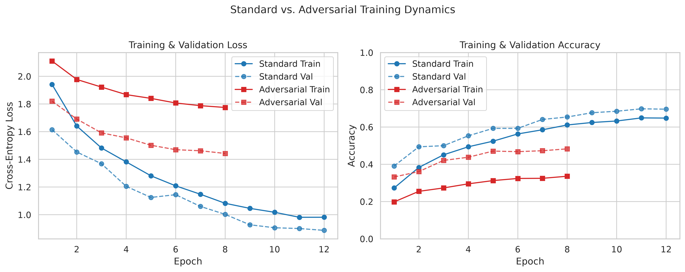
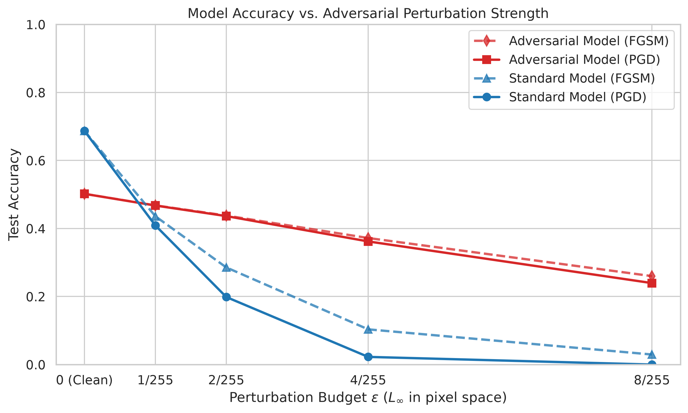
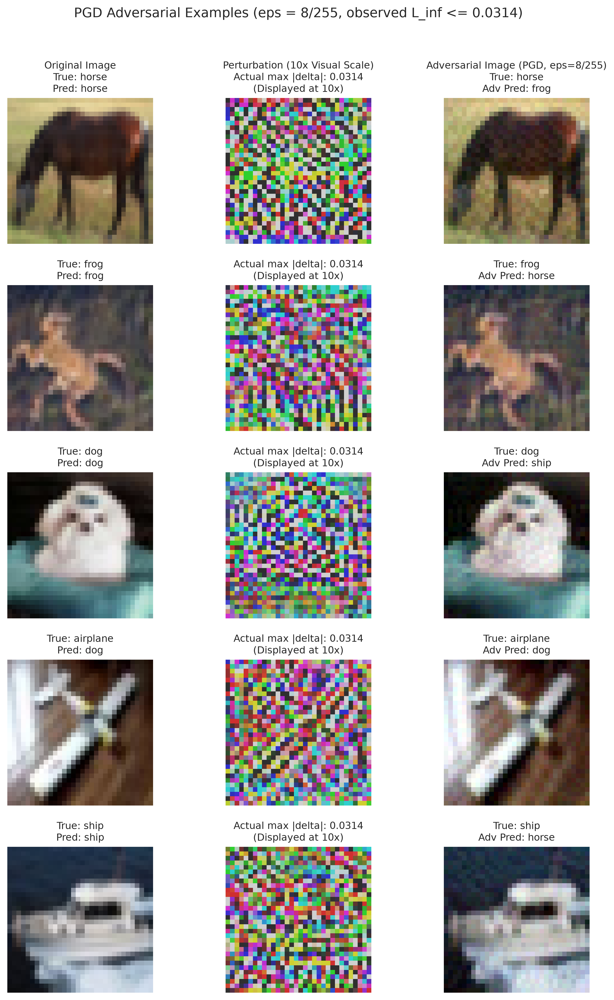
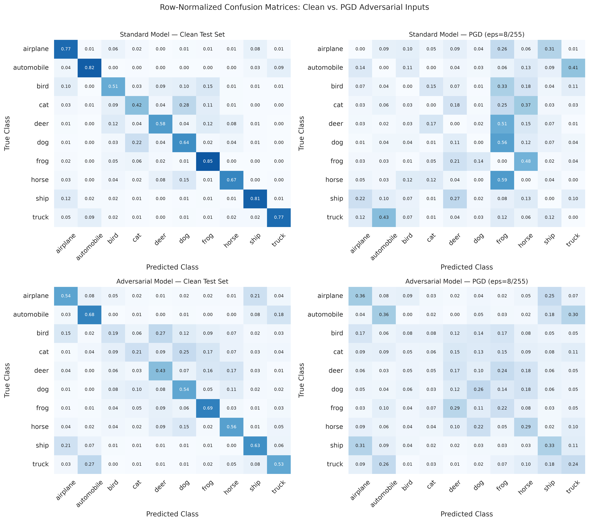
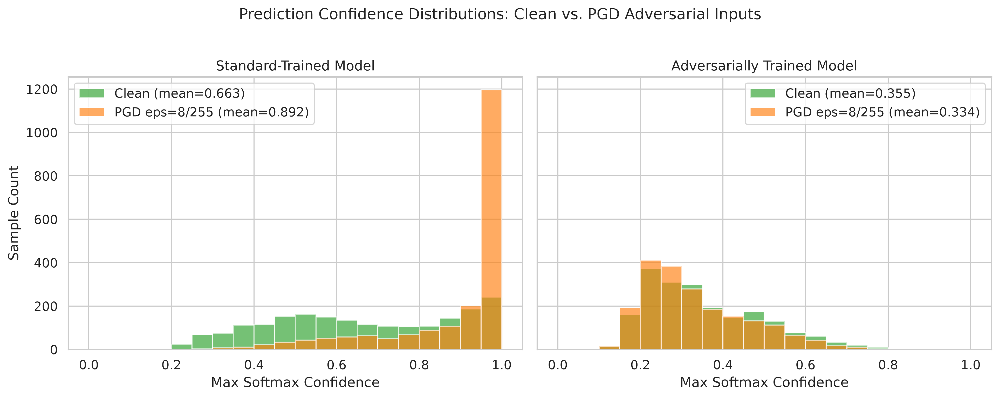
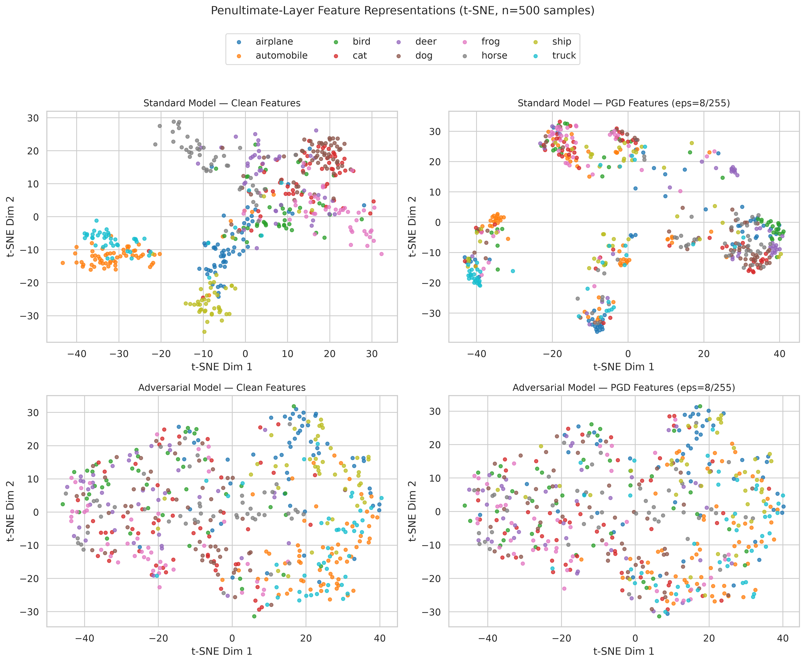

# CIFAR-10 Image Classifier Robustness Report Card


A reproducible, CPU-friendly PyTorch benchmark that evaluates image classifier robustness on **CIFAR-10** under **$L_\infty$ FGSM** and **PGD** adversarial attacks, implements **PGD adversarial training**, and compiles a comprehensive quantitative and visual robustness report card.

---

## Table of Contents

1. [Project Overview](#project-overview)
2. [Outcomes Overview (Executive Summary)](#outcomes-overview-executive-summary)
3. [Repository Structure](#repository-structure)
4. [Methodology & Experimental Configuration](#methodology--experimental-configuration)
5. [Step-by-Step Installation & Running Guide](#step-by-step-installation--running-guide)
6. [Quantitative Robustness Report Card](#quantitative-robustness-report-card)
7. [Visual Analysis & Diagnostic Figures](#visual-analysis--diagnostic-figures)
8. [Key Insights & Lessons Learned](#key-insights--lessons-learned)
9. [Limitations & Future Work](#limitations--future-work)
10. [References & License](#references--license)

---

## Project Overview

Standard convolutional neural networks achieve strong accuracy on clean test images yet fail dramatically under tiny, human-imperceptible adversarial perturbations. This project systematically audits and defends a lightweight CIFAR-10 CNN entirely on CPU:

* **Baseline Training:** Trains a compact 3-block CNN (`CIFAR10CNN`, 304,794 trainable parameters) on CIFAR-10.
* **White-Box Threat Evaluation:** Benchmarks the classifier against both single-step **Fast Gradient Sign Method (FGSM)** and multi-step **Projected Gradient Descent (PGD)** across five $L_\infty$ perturbation budgets ($\epsilon \in \{0, 1/255, 2/255, 4/255, 8/255\}$) strictly projected in pixel space $[0, 1]$.
* **Adversarial Defense:** Trains a robust counterpart via **PGD Adversarial Training** ($\epsilon = 4/255$, 3 inner steps) and re-evaluates it across the full attack suite.
* **Multi-Faceted Diagnostics:** Tracks clean accuracy, adversarial accuracy, Attack Success Rate (ASR), prediction confidence calibration, per-class confusion matrices, and 2D t-SNE projections of penultimate-layer feature representations.

---

## Outcomes Overview (Executive Summary)

The table below summarizes the headline comparison between the **Standard-Trained Model** and the **Adversarially Trained Model** on the 2,000-image CIFAR-10 test subset (`seed=42`, CPU):

| Metric | Standard Model | Adversarial Model | Net Shift (Adv vs. Std) |
| :--- | :---: | :---: | :---: |
| **Peak Validation Accuracy (Clean)** | `69.80%` (Epoch 11) | `48.30%` (Epoch 8) | `-21.50%` |
| **Test Clean Accuracy ($\epsilon = 0$)** | `69.65%` | `50.20%` | `-19.45%` |
| **PGD Accuracy ($\epsilon = 4/255$)** | `3.15%` | `36.20%` | `+33.05%` |
| **PGD Accuracy ($\epsilon = 8/255$)** | `0.05%` | `23.95%` | `+23.90%` |
| **PGD Attack Success Rate ($\epsilon = 8/255$)** | `99.93%` | `52.49%` | `-47.44%` |
| **Mean Clean Softmax Confidence** | `0.6817` | `0.3546` | `-0.3271` |
| **Mean PGD Softmax Confidence ($\epsilon = 8/255$)** | `0.9015` | `0.3337` | `-0.5678` |

**Bottom Line:** Standard training produces a brittle model that collapses from **69.65%** clean accuracy to **0.05%** under PGD ($\epsilon = 8/255$) while becoming *more* confident in its wrong predictions (mean confidence jumps from **0.6817** to **0.9015**). PGD adversarial training trades **19.45%** of clean accuracy to recover **+23.90%** PGD accuracy at $\epsilon = 8/255$, cuts Attack Success Rate nearly in half, and preserves stable confidence and feature geometry under attack.

---

## Repository Structure

```text
cifar10-robustness-report-card/
├── config.py                            # Centralized hyperparameters, paths, seeds, and attack settings
├── main.py                              # End-to-end CLI pipeline (train, attack, evaluate, plot, report)
├── requirements.txt                     # Python package dependencies
├── README.md                            # Complete project documentation and robustness report card
├── LICENSE                              # MIT License
├── .gitignore                           # Ignores raw datasets, model checkpoints, caches, and temp files
├── src/
│   ├── __init__.py                      # Package exports
│   ├── data.py                          # Deterministic CIFAR-10 loading, subsetting, and DataLoaders
│   ├── model.py                         # CIFAR10CNN architecture (3 conv blocks + feature extraction)
│   ├── attacks.py                       # Pixel-space L_inf FGSM and PGD implementations
│   ├── train.py                         # Standard and PGD adversarial training loops + checkpointing
│   ├── evaluate.py                      # Clean/adversarial accuracy, ASR, confidence, and confusion metrics
│   └── plots.py                         # 300-DPI portfolio figure generation utilities
├── notebooks/
│   └── robustness_report_card.ipynb     # Interactive end-to-end walkthrough notebook with inline outputs
├── figures/
│   ├── training_curves.png              # Train/val loss and accuracy curves (Standard vs. Adversarial)
│   ├── accuracy_vs_epsilon.png          # Accuracy degradation across epsilon for FGSM and PGD
│   ├── adversarial_examples_grid.png    # Original, 10x amplified perturbation, and adversarial image grid
│   ├── confusion_matrices.png           # Row-normalized 10-class confusion matrices (Clean vs. PGD)
│   ├── confidence_histograms.png        # Max softmax confidence distributions (Clean vs. PGD)
│   └── tsne_features.png                # 2D t-SNE embeddings of penultimate-layer features
├── results/
│   ├── evaluation_metrics.csv           # Full tabular evaluation log across models, attacks, and epsilons
│   ├── robustness_report_card.md        # Auto-generated markdown report card summary
│   ├── standard_history.json            # Epoch-by-epoch loss and accuracy log (Standard model)
│   └── adversarial_history.json         # Epoch-by-epoch loss and accuracy log (Adversarial model)
├── checkpoints/                         # Saved .pt weights (generated locally; excluded from Git)
└── data/                                # Auto-downloaded CIFAR-10 dataset (excluded from Git)
```

---

## Methodology & Experimental Configuration

### 1. Dataset & Hardware Budget
* **Dataset:** [CIFAR-10](https://www.cs.toronto.edu/~kriz/cifar.html) ($32 \times 32$ RGB images across 10 mutually exclusive classes: `airplane`, `automobile`, `bird`, `cat`, `deer`, `dog`, `frog`, `horse`, `ship`, `truck`). Automatically downloaded via `torchvision.datasets.CIFAR10(download=True)`.
* **Subsets (CPU-Optimized):** `9,000` training images, `1,000` validation images (`10,000` combined train+val), and `2,000` test images, loaded in mini-batches of `128`.
* **Execution Environment:** Reproducible CPU-only execution (`device="cpu"`, `seed=42`).

### 2. Model Architecture (`CIFAR10CNN`)
* Lightweight 3-block convolutional neural network with Batch Normalization, ReLU activations, Max Pooling, Dropout, an **80-dimensional penultimate feature layer** (exposed for t-SNE representation analysis), and a 10-class linear head.
* **Trainable Parameters:** `304,794`.

### 3. Training & Defense Hyperparameters

| Parameter | Standard Training | Adversarial Training (PGD) |
| :--- | :---: | :---: |
| **Epochs** | `12` | `8` |
| **Optimizer** | `Adam` | `Adam` |
| **Learning Rate** | `0.001` | `0.001` |
| **Batch Size** | `128` | `128` |
| **Inner Attack** | None (Clean Inputs) | PGD ($L_\infty$, $\epsilon = 4/255$, `3` steps) |

### 4. White-Box Attack Formulations
All perturbations are computed and bounded strictly in valid pixel space $x_{\text{adv}} \in [0, 1]^{3 \times 32 \times 32}$ under the $L_\infty$ norm constraint $\|x_{\text{adv}} - x\|_\infty \le \epsilon$:

* **FGSM (Fast Gradient Sign Method):**
  $$x_{\text{adv}} = \text{Clip}_{[0,1]}\!\left(x + \epsilon \cdot \text{sign}\!\left(\nabla_x \mathcal{L}(f_\theta(x), y)\right)\right)$$

* **PGD (Projected Gradient Descent, 10 evaluation steps with random start):**
  $$x^{(t+1)} = \Pi_{\mathcal{B}_\infty(x, \epsilon) \cap [0,1]}\!\left(x^{(t)} + \alpha \cdot \text{sign}\!\left(\nabla_{x^{(t)}} \mathcal{L}(f_\theta(x^{(t)}), y)\right)\right)$$

* **Perturbation Budgets Evaluated:** $\epsilon \in \left\{0,\; \frac{1}{255},\; \frac{2}{255},\; \frac{4}{255},\; \frac{8}{255}\right\}$ (where $\frac{8}{255} \approx 0.031373$).

### 5. Evaluation Metrics
* **Clean Accuracy:** Fraction of unperturbed test samples classified correctly.
* **Adversarial Accuracy:** Fraction of adversarially perturbed test samples classified correctly.
* **Attack Success Rate (ASR):** Fraction of *initially correct* clean predictions flipped to an incorrect class under attack:
  $$\text{ASR} = \frac{\left|\{i : \hat{y}(x_i) = y_i \;\wedge\; \hat{y}(x_i^{\text{adv}}) \neq y_i\}\right|}{\left|\{i : \hat{y}(x_i) = y_i\}\right|}$$
* **Mean Prediction Confidence:** Average maximum softmax probability $\frac{1}{N}\sum_{i=1}^{N} \max_c P(y = c \mid x_i)$ across evaluated samples.

---

## Step-by-Step Installation & Running Guide

### Prerequisites
* **Python 3.10+** installed on your machine
* **Git** and **pip**
* No GPU required (designed to run completely on CPU)

---

### Step 1: Clone the Repository

```bash
git clone https://github.com/farianishat/cifar10-robustness-report-card.git
cd cifar10-robustness-report-card
```

---

### Step 2: Create and Activate a Virtual Environment

**Linux / macOS:**
```bash
python3 -m venv .venv
source .venv/bin/activate
```

**Windows (PowerShell):**
```powershell
python -m venv .venv
.\.venv\Scripts\Activate.ps1
```

**Windows (Command Prompt / CMD):**
```cmd
python -m venv .venv
.venv\Scripts\activate.bat
```

---

### Step 3: Install Dependencies

Upgrade `pip` and install all packages from `requirements.txt`:

```bash
python -m pip install --upgrade pip
pip install -r requirements.txt
```

*(Optional — Lightweight CPU-Only PyTorch Wheel)*: If you want to minimize download size on a CPU-only machine, install CPU builds of PyTorch and Torchvision first, then install the remaining dependencies:

```bash
pip install torch torchvision --index-url https://download.pytorch.org/whl/cpu
pip install -r requirements.txt
```

Verify your environment before running:

```bash
python -c "import torch, torchvision, sklearn, matplotlib, seaborn; print('PyTorch:', torch.__version__, '| CUDA:', torch.cuda.is_available())"
```

---

### Step 4: Run the Project

You can run the full pipeline via the **Python CLI script (`.py`)** or interactively via the **Jupyter Notebook (`.ipynb`)**. Both load the exact same modular codebase from `config.py` and `src/` and automatically download CIFAR-10 (~170 MB) into `data/` on the first run.

#### Option A: Run the End-to-End Python Pipeline (`main.py`)

Execute the complete workflow (data loading, standard training, adversarial training, FGSM & PGD evaluation across all $\epsilon$ values, 300-DPI figure generation, and markdown/CSV/JSON report export):

```bash
python main.py
```

To inspect any available CLI flags or runtime options supported by `main.py`:

```bash
python main.py --help
```

> **Customizing Hyperparameters:** Open `config.py` to adjust the random seed, subset sizes (`10,000` train+val / `2,000` test), training epochs, learning rate, batch size, PGD step counts, or $\epsilon$ sweep values, then re-run `python main.py`.

#### Option B: Run the Jupyter Notebook (`notebooks/robustness_report_card.ipynb`)

**Interactive Mode (Jupyter Notebook):**
```bash
jupyter notebook notebooks/robustness_report_card.ipynb
```

**Interactive Mode (JupyterLab):**
```bash
jupyter lab notebooks/robustness_report_card.ipynb
```
Inside Jupyter, select **Kernel $\rightarrow$ Restart & Run All** to execute every cell sequentially from top to bottom.

**Headless / Command-Line Notebook Execution (No Browser Needed):**
```bash
jupyter nbconvert --to notebook --execute --inplace notebooks/robustness_report_card.ipynb
```

#### Option C: Quick Sanity Check of Individual `src/` Modules

You can import and verify individual components directly from the command line:

```bash
python -c "import torch; from src.model import CIFAR10CNN; m = CIFAR10CNN(); x = torch.randn(4, 3, 32, 32); print('Params:', sum(p.numel() for p in m.parameters() if p.requires_grad), '| Logits:', m(x).shape)"
```

---

### Step 5: Inspect Generated Artifacts

After running either `main.py` or `notebooks/robustness_report_card.ipynb`, verify that all outputs are populated:

```bash
ls -lh checkpoints/ results/ figures/
```

Expected generated files:
* **Checkpoints (`checkpoints/`):** `standard_cnn.pt`, `adversarial_cnn.pt`
* **Metrics & Logs (`results/`):** `evaluation_metrics.csv`, `robustness_report_card.md`, `standard_history.json`, `adversarial_history.json`
* **Visualizations (`figures/`):** `training_curves.png`, `accuracy_vs_epsilon.png`, `adversarial_examples_grid.png`, `confusion_matrices.png`, `confidence_histograms.png`, `tsne_features.png`

---

## Quantitative Robustness Report Card

### Consolidated PGD Evaluation Table (2,000 Test Samples)

Recorded directly in [`results/robustness_report_card.md`](results/robustness_report_card.md) and [`results/evaluation_metrics.csv`](results/evaluation_metrics.csv):

| Model | $\epsilon$ ($L_\infty$) | Clean Accuracy | Adversarial Accuracy | Attack Success Rate (ASR) | Mean Clean Confidence | Mean Adversarial Confidence |
| :--- | :---: | :---: | :---: | :---: | :---: | :---: |
| **Standard** | `0/255` | `69.65%` | `69.65%` | `0.00%` | `0.6817` | `0.6817` |
| **Standard** | `1/255` | `69.65%` | `44.05%` | `36.76%` | `0.6817` | `0.6437` |
| **Standard** | `2/255` | `69.65%` | `21.95%` | `68.49%` | `0.6817` | `0.6674` |
| **Standard** | `4/255` | `69.65%` | `3.15%` | `95.48%` | `0.6817` | `0.7815` |
| **Standard** | `8/255` | `69.65%` | `0.05%` | `99.93%` | `0.6817` | `0.9015` |
| **Adversarial** | `0/255` | `50.20%` | `50.20%` | `0.00%` | `0.3546` | `0.3546` |
| **Adversarial** | `1/255` | `50.20%` | `46.75%` | `7.07%` | `0.3546` | `0.3493` |
| **Adversarial** | `2/255` | `50.20%` | `43.65%` | `13.35%` | `0.3546` | `0.3448` |
| **Adversarial** | `4/255` | `50.20%` | `36.20%` | `28.29%` | `0.3546` | `0.3379` |
| **Adversarial** | `8/255` | `50.20%` | `23.95%` | `52.49%` | `0.3546` | `0.3337` |

### Training Progression Summary (`standard_history.json` & `adversarial_history.json`)

| Model | Start Train Loss | Final Train Loss | Start Val Loss | Final Val Loss | Final Train Acc | Peak Val Acc | Final Val Acc |
| :--- | :---: | :---: | :---: | :---: | :---: | :---: | :---: |
| **Standard (12 Epochs)** | `1.9417` | `0.9818` | `1.6149` | `0.8872` | `64.82%` | `69.80%` (Ep 11) | `69.60%` |
| **Adversarial (8 Epochs)** | `2.1105` | `1.7750` | `1.8205` | `1.4428` | `33.60%` | `48.30%` (Ep 8) | `48.30%` |

---

## Visual Analysis & Diagnostic Figures

All figures below are generated automatically at 300 DPI and stored in `figures/`.

### 1. Standard vs. Adversarial Training Dynamics



* **Standard Training:** Cross-entropy loss decreases steadily over 12 epochs (`1.94` $\rightarrow$ `0.98` train; `1.61` $\rightarrow$ `0.89` val), pushing clean validation accuracy to **69.8%**.
* **Adversarial Training:** Training loss remains substantially higher (`2.11` $\rightarrow$ `1.78`) and training accuracy reaches `33.6%` because every training batch is perturbed online with 3-step PGD ($\epsilon = 4/255$). Clean validation accuracy climbs steadily to **48.3%** with zero overfitting.

---

### 2. Accuracy vs. Perturbation Strength (FGSM & PGD)



* **Robustness Crossover at $\epsilon = 1/255$:** Even at the smallest non-zero perturbation ($\epsilon = 1/255$, changing each pixel by at most 1 out of 255 intensity levels), the Standard model loses over 25 percentage points under PGD and falls behind the Adversarial model.
* **Iterative vs. Single-Step Attacks:** PGD consistently inflicts steeper accuracy drops than single-step FGSM on the Standard model (especially at $\epsilon = 2/255$ and $4/255$). On the Adversarially Trained model, FGSM and PGD curves remain closely aligned and degrade smoothly, retaining **23.95%** PGD accuracy even at $\epsilon = 8/255$ (twice its training radius of $4/255$).

---

### 3. Visual Inspection of Adversarial Perturbations (PGD, $\epsilon = 8/255$)



* Every perturbation obeys the strict pixel-space constraint $\max |\delta| \le 0.0314$ (`8/255`).
* Although the original (left) and adversarial (right) images look nearly indistinguishable to the human eye, targeted high-frequency noise (center, shown at $10\times$ visual scale) reliably flips predictions across unrelated categories (e.g., `horse` $\rightarrow$ `frog`, `frog` $\rightarrow$ `horse`, `dog` $\rightarrow$ `ship`, `ship` $\rightarrow$ `horse`).

---

### 4. Per-Class Confusion Matrices (Clean vs. PGD $\epsilon = 8/255$)



* **Standard Model (Top Row):** Shows a crisp clean diagonal (`frog` `0.85`, `automobile` `0.82`, `ship` `0.81`, `airplane` `0.77`, `truck` `0.77`) with natural visual confusions (`cat` $\leftrightarrow$ `dog`). Under PGD (`eps=8/255`), the diagonal completely vanishes (`0.00` across classes) as predictions funnel into specific adversarial sinks (`horse` $\rightarrow$ `frog` at `0.59`, `dog` $\rightarrow$ `frog` at `0.56`, `deer` $\rightarrow$ `frog` at `0.51`, `truck` $\rightarrow$ `automobile` at `0.43`).
* **Adversarial Model (Bottom Row):** Exhibits lower clean diagonal scores (notably on fine-grained classes like `bird` and `cat`), but retains a clear diagonal structure under PGD (`airplane` `0.36`, `automobile` `0.36`, `ship` `0.33`, `horse` `0.29`, `dog` `0.26`), preventing systemic class collapse.

---

### 5. Prediction Confidence Distributions (Clean vs. PGD $\epsilon = 8/255$)



* **Overconfident Misclassification in the Standard Model:** On clean inputs, softmax confidence is spread across `[0.2, 1.0]` (`mean` $\approx 0.663$–$0.682$). Under PGD ($\epsilon = 8/255$), the distribution slams into the `0.95–1.00` bin (`mean` $\approx 0.892$–$0.902$)—meaning the model is nearly **100% wrong** while reporting **~90% confidence**. *(Small `~0.01` differences between the CLI report table and plotted histogram reflect random PGD restarts and best-validation checkpoint evaluation across runs.)*
* **Calibrated Stability in the Adversarial Model:** Clean (`mean = 0.355`) and PGD (`mean = 0.334`) confidence histograms overlap closely, eliminating pathological overconfidence under attack.

---

### 6. Penultimate-Layer Feature Space Geometry (t-SNE, $n = 500$)



* **Standard Model (Top Row):** Clean penultimate features form well-separated clusters (such as `ship`, `horse`, and `automobile`/`truck`). Under PGD ($\epsilon = 8/255$), those clusters fracture and collapse into mixed, overlapping adversarial regions.
* **Adversarial Model (Bottom Row):** Clean embeddings are more diffuse (reflecting the clean accuracy trade-off), yet the spatial structure between Clean and PGD features remains visually almost invariant—confirming that adversarial training regularizes internal representations against bounded $L_\infty$ perturbations.

---

## Key Insights & Lessons Learned

1. **Clean Accuracy Alone Hides Severe Brittleness:** A classifier achieving nearly `70%` accuracy on clean CIFAR-10 images can be reduced to `0.05%` accuracy (`99.93%` ASR) with pixel perturbations invisible to humans.
2. **The Robustness–Accuracy Trade-Off Is Real and Measurable:** PGD adversarial training reduced clean test accuracy by `19.45%` (`69.65%` $\rightarrow$ `50.20%`) in exchange for a `+23.90%` gain in PGD accuracy at $\epsilon = 8/255$ (`0.05%` $\rightarrow$ `23.95%`) and `+33.05%` at $\epsilon = 4/255$ (`3.15%` $\rightarrow$ `36.20%`).
3. **Confidence Scores Cannot Be Trusted on Standard Models Under Attack:** High softmax probability does not imply correctness—adversarial examples push standard classifiers *further* away from decision boundaries into high-confidence error zones (`0.90` mean confidence at near-zero accuracy).
4. **Generalization Beyond Training Radius:** Even though adversarial training only used 3-step PGD at $\epsilon = 4/255$ to stay CPU-friendly, the resulting model maintained meaningful robustness against stronger 10-step PGD at $\epsilon = 8/255$.
5. **Representation Stability Drives Robustness:** Comparing penultimate-layer t-SNE plots directly shows *why* adversarial training works: it suppresses brittle, high-frequency features so internal activations barely drift under bounded perturbations.

---

## Limitations & Future Work

* **CPU Subset & Capacity Constraints:** Training used a 10,000-sample subset, a 305k-parameter CNN, and 8 epochs of 3-step PGD adversarial training to keep CPU runtimes practical. Scaling to the full 50,000-image training set with a wider ResNet-18/WideResNet architecture on GPU would substantially raise both clean and robust accuracy.
* **Stronger & Diverse Threat Models:** Future iterations can expand evaluation beyond $L_\infty$ FGSM/PGD to include $L_2$ PGD, Carlini–Wagner (C&W), AutoAttack (APGD-CE/DLR + FAB + Square Attack), and common corruptions (CIFAR-10-C).
* **Advanced Defenses:** Incorporating **TRADES**, **MART**, cosine learning-rate schedules, and stronger data augmentation (e.g., Cutout/AutoAugment) can improve the Pareto frontier between clean accuracy and adversarial robustness.
* **Uncertainty & Calibration:** Evaluating Expected Calibration Error (ECE), temperature scaling, and adversarial detection via feature-space distances would further strengthen deployment readiness.

---

## References & License

### References
* Krizhevsky, A. (2009). *Learning Multiple Layers of Features from Tiny Images*. University of Toronto Technical Report.
* Goodfellow, I. J., Shlens, J., & Szegedy, C. (2015). *Explaining and Harnessing Adversarial Examples* (FGSM). ICLR 2015.
* Madry, A., Makelov, A., Schmidt, L., Tsipras, D., & Vladu, A. (2018). *Towards Deep Learning Models Resistant to Adversarial Attacks* (PGD & Adversarial Training). ICLR 2018.

### License
This project is released under the **MIT License**. See [`LICENSE`](LICENSE) for full details.